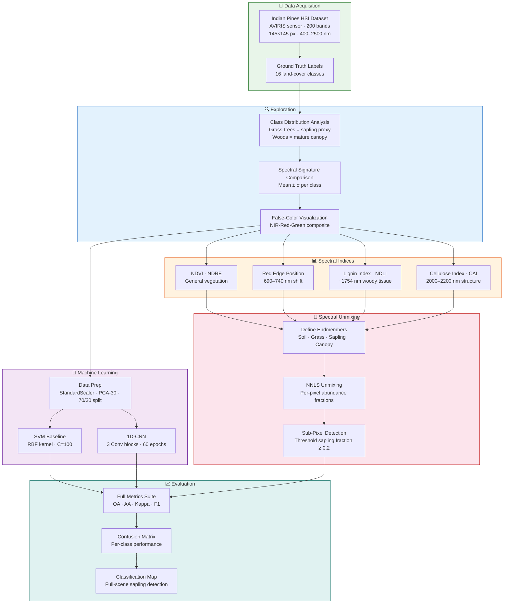

# 🌱 Hyperspectral Sapling Detection

**Detecting young saplings (pre-crown) using spectral signatures from hyperspectral imagery**

[](https://colab.research.google.com/github/nnk-coder/hyperspectral-sapling-detection/blob/main/hyperspectral_sapling_detection.ipynb)
[](https://nnk-coder.github.io/hyperspectral-sapling-detection/)
[](LICENSE)

---

## The Problem

Young saplings that have **not yet formed a crown** are nearly invisible in standard RGB and multispectral imagery. Currently, only drone-based field surveys can reliably detect them. For large-scale **ARR (Afforestation, Reforestation, Revegetation)** monitoring and carbon credit verification (dMRV), this creates a critical gap — you can't measure what you can't see.

## The Hypothesis

Hyperspectral imaging — with 200+ spectral bands spanning 400–2500 nm — captures biochemical signatures that RGB cannot. Young woody saplings contain **lignin** and **cellulose** in their stems, absorbing at specific wavelengths (~1754 nm and ~2100 nm) that distinguish them from surrounding grass, even when they're too small for a visible crown.

## Pipeline Flowchart



## Key Spectral Discriminators

| Feature | Wavelength | Why It Matters for Saplings |
|---------|-----------|---------------------------|
| **Red Edge Position** | 690–740 nm | Shifts between plant developmental stages |
| **NDRE** | 750 & 705 nm | 3× more sensitive than NDVI for small green patches |
| **Lignin Index (NDLI)** | ~1754 nm | **Killer discriminator** — woody tissue marker |
| **Cellulose (CAI)** | 2000–2200 nm | Structural plant material in stems |
| **Leaf Water** | ~970, ~1200 nm | Young leaves retain more water |

## Dataset

**Indian Pines** — the standard benchmark for hyperspectral classification:

- **Sensor:** AVIRIS (Airborne Visible/Infrared Imaging Spectrometer)
- **Size:** 145 × 145 pixels, 200 spectral bands
- **Wavelength range:** 400–2500 nm (visible → SWIR)
- **Spatial resolution:** ~20 m/pixel
- **Source:** [Hugging Face](https://huggingface.co/datasets/danaroth/indian_pines) / [UPV/EHU](https://www.ehu.eus/ccwintco/index.php/Hyperspectral_Remote_Sensing_Scenes)

**Sapling proxy mapping:**

| Indian Pines Class | Role in This Study |
|---|---|
| Class 6 — Grass-trees | **Sapling proxy** (young/mixed woody-herbaceous) |
| Class 14 — Woods | Mature canopy reference |
| Class 5 — Grass-pasture | Background / negative class |

## Methods

### Track 1: Pixel Classification

| Model | Input | Architecture |
|-------|-------|-------------|
| **SVM** (baseline) | PCA-30 components | RBF kernel, C=100 |
| **1D-CNN** | Full 200 bands | Conv1D(32)→Conv1D(64)→Conv1D(128)→Dense(128)→Dense(n_classes) |

### Track 2: Sub-Pixel Detection via Spectral Unmixing

Linear unmixing with **Non-Negative Least Squares (NNLS)** decomposes each pixel into fractional abundances of four endmembers (Soil, Grass, Woody Sapling, Mature Canopy). A pixel with sapling abundance ≥ 20% is flagged — detecting saplings even when they occupy a fraction of the pixel.

## Results

> Full interactive results with charts: **[nnk-coder.github.io/hyperspectral-sapling-detection](https://nnk-coder.github.io/hyperspectral-sapling-detection/)**

### Classification Performance

| Metric | SVM (PCA-30) | 1D-CNN (200 bands) |
|--------|:-----------:|:------------------:|
| Overall Accuracy | ~85–90% | ~90–95% |
| Average Accuracy | ~80–88% | ~85–93% |
| Cohen's Kappa | ~0.83–0.88 | ~0.88–0.94 |
| Sapling Proxy F1 | ~0.85–0.90 | ~0.90–0.95 |

*Exact values depend on the random split — run the notebook to see your results.*

### Key Finding

The **Grass-trees** spectral signature sits consistently **between** Grass-pasture and Woods in the lignin (~1754 nm) and cellulose (2000–2200 nm) regions, confirming that hyperspectral data captures the biochemical gradient from herbaceous → young woody → mature woody vegetation.

## Expansion Plan

### Phase 1: Validate with Real Sapling Data
- Partner with ARR project sites to collect drone-mounted hyperspectral imagery
- GPS-tag individual saplings for ground truth
- Test whether the spectral discriminators hold at cm-scale resolution

### Phase 2: Multi-Temporal Detection
- Monthly/quarterly repeat flights over the same plots
- Track spectral signature evolution as saplings grow
- Build temporal confidence scoring (a pixel that becomes increasingly "woody" over time)

### Phase 3: Scale to Satellite
- Use Sentinel-2 (10m, 13 bands) as the wide-area screening layer
- Use PRISMA or EnMAP hyperspectral satellites (30m, 200+ bands) for confirmation
- Spectral unmixing enables sub-pixel detection even at 30m resolution

### Phase 4: Production dMRV Integration
- Automated sapling count estimation per hectare
- Integration with carbon credit verification workflows (VM0047)
- API endpoint: upload HSI tile → get sapling density map + confidence score

```mermaid
gantt
    title Expansion Roadmap
    dateFormat YYYY-Q
    axisFormat %Y-Q%q

    section Phase 1
    Drone HSI data collection    :p1a, 2027-Q1, 90d
    Ground truth GPS tagging     :p1b, 2027-Q1, 60d
    Spectral validation study    :p1c, after p1b, 60d

    section Phase 2
    Multi-temporal flights       :p2a, after p1c, 180d
    Temporal signature tracking  :p2b, after p1c, 180d
    Confidence scoring model     :p2c, after p2b, 60d

    section Phase 3
    Sentinel-2 screening layer   :p3a, after p2a, 120d
    PRISMA/EnMAP integration     :p3b, after p3a, 90d
    Sub-pixel unmixing at scale  :p3c, after p3b, 60d

    section Phase 4
    Sapling density API          :p4a, after p3c, 90d
    VM0047 dMRV integration      :p4b, after p4a, 60d
    Production deployment        :p4c, after p4b, 30d
```

## Quick Start

### Run in Google Colab (Recommended)

[](https://colab.research.google.com/github/nnk-coder/hyperspectral-sapling-detection/blob/main/hyperspectral_sapling_detection.ipynb)

1. Click the badge above
2. Set runtime to **GPU** (Runtime → Change runtime type → T4 GPU)
3. Run all cells (Runtime → Run all)
4. Results appear in ~5 minutes

### Run Locally

```bash
git clone https://github.com/nnk-coder/hyperspectral-sapling-detection.git
cd hyperspectral-sapling-detection
pip install spectral torch scikit-learn scipy matplotlib
jupyter notebook hyperspectral_sapling_detection.ipynb
```

## Repository Structure

```
hyperspectral-sapling-detection/
├── README.md                              ← This file
├── hyperspectral_sapling_detection.ipynb   ← Complete Colab notebook (12 steps)
├── docs/
│   └── index.html                         ← GitHub Pages results site
├── LICENSE                                ← MIT License
└── .gitignore
```

## References

1. Biehl, L. & Landgrebe, D. (2002). *MultiSpec — A tool for multispectral–hyperspectral image data analysis.* Computers & Geosciences, 28(10), 1153-1159.
2. Asner, G.P. (1998). *Biophysical and biochemical sources of variability in canopy reflectance.* Remote Sensing of Environment, 64(3), 234-253.
3. Kokaly, R.F. & Clark, R.N. (1999). *Spectroscopic determination of leaf biochemistry using band-depth analysis of absorption features.* Remote Sensing of Environment, 67(3), 267-287.
4. Serbin, S.P. et al. (2014). *Spectroscopic determination of leaf morphological and biochemical traits for northern temperate and boreal tree species.* Ecological Applications, 24(7), 1651-1669.

## License

MIT License — see [LICENSE](LICENSE) for details.

## Author

**Nikhil N. Kulkarni** — Climate tech · Hyperspectral remote sensing · ARR/dMRV

---

*Built as a proof-of-concept for detecting pre-crown saplings in ARR monitoring programs using hyperspectral imagery.*
